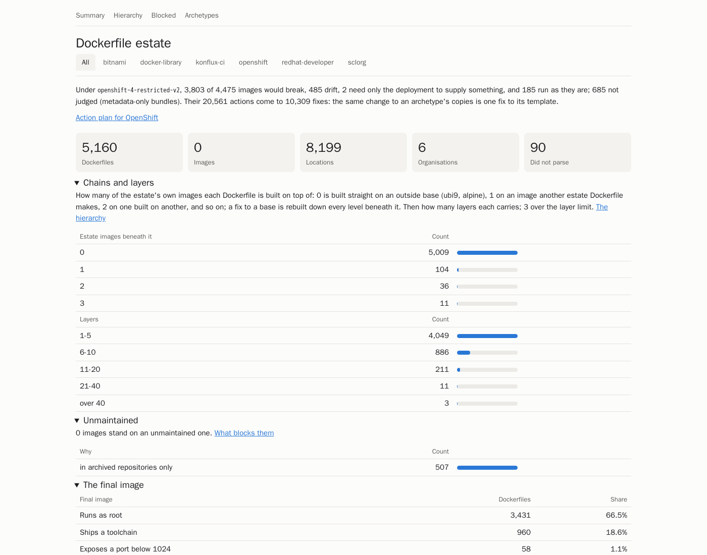

# Dockerfile Inventory

[](https://github.com/fiftiesHousewife/Dockerfile-Inventory/actions/workflows/check.yml)
[](LICENSE)
[](https://adoptium.net/)

Finds every Dockerfile across your GitHub organisations and tells you what your estate is built from and what to
fix first.

- **Discovers** each Dockerfile at the commit that was last released, and reads each distinct one once.
- **Catalogues** each one: its base images, users, packages, runtimes, and how many distinct kinds of Dockerfile
  there really are (archetypes).
- **Links** the images in Artifactory back to the Dockerfiles that built them, through their layers.
- **Checks** them against quality rules (secrets, unpinned bases, root users, cache left behind, ...).
- **Judges** each image, and each Kubernetes workload, as OpenShift would run it, and turns what breaks into a
  ranked list of fixes.
- **Converts** each Dockerfile to a typed model and back, to prove it can be rewritten safely.

What you get is a folder per stage and an HTML report: the estate's overview, each Dockerfile's page, the archetypes,
the image hierarchy, and the OpenShift action plan. Here is the summary for six public organisations (8,199
Dockerfile locations, without lineage):



More pages: [the OpenShift action plan](docs/images/report-openshift.png) and
[the archetypes](docs/images/report-archetypes.png).

## Quick start

You need Java 21 or newer and a token that can read the organisations.

```bash
./gradlew :cli:installDist                                   # until the first release: build the command
export PATH="$PWD/cli/build/install/docker-inventory/bin:$PATH"

export GHE_TOKEN_FILE=~/secrets/ghe-token
docker-inventory survey --try --load gentle https://github.example.com/acme
```

`--load` says how hard to press GitHub and Artifactory, and is required: `gentle` (GitHub 2 calls a second, 2
repositories at once; Artifactory 5 a second, 4 images at once) or `normal` (10 and 8; 20 and 16). Whatever the load,
the run slows down by itself when the servers do. A try stops after ten repositories that hold a Dockerfile, so it proves the token and the network in a few minutes.
Its last line says where the report is: open `out/acme-try/report/index.html`.

## Examples

Survey a whole organisation, or several as one estate:

```bash
docker-inventory survey --load normal https://github.example.com/acme
docker-inventory survey --load normal https://github.example.com/acme https://github.example.com/beta
```

On GitHub.com or GitHub Enterprise Cloud, the URL is the organisation's:

```bash
GHE_TOKEN=$(env -u GITHUB_TOKEN gh auth token) docker-inventory survey --try --load gentle https://github.com/openshift
```

Scan part of an organisation: one repository, or every one whose name holds a word. After listing the repositories
and their files, it says how many Dockerfiles it found and how long the rest will take, and asks before fetching:

```bash
docker-inventory survey --load gentle --repository acme/payments-api https://github.example.com/acme
docker-inventory survey --load gentle --repository-name-contains billing https://github.example.com/acme
```

```
42 repositories selected, 37 with Dockerfiles: 118 Dockerfiles, 96 distinct
260 more calls to GitHub at 2 a second, then the other stages: about 3 minutes
output in out/acme-billing
Continue? [y/N]
```

In a script, `--yes` goes on without asking, and `--max-dockerfiles 500` stops (exit 3) when the first pass finds
more, so a selection that is wider than meant never runs.

Link the images in Artifactory too (lineage runs whenever `ARTIFACTORY_URL` is set):

```bash
export ARTIFACTORY_URL=https://artifactory.example.com/artifactory
export ARTIFACTORY_TOKEN_FILE=~/secrets/artifactory-token
docker-inventory survey --load gentle https://github.example.com/acme
```

Judge for the older OpenShift `restricted` SCC instead of `restricted-v2`:

```bash
PROFILE=openshift-4-restricted docker-inventory survey --load gentle https://github.example.com/acme
```

Rerun one stage on what the others wrote, here the validator:

```bash
FACTS_DIR=out/acme/facts DISCOVERY_DIR=out/acme/discovery OUT_DIR=out/acme/validator \
    docker-inventory validator
```

See every call to GitHub while it runs, or send JSON logs to a collector:

```bash
docker-inventory --verbose survey --try --load gentle https://github.example.com/acme
LOG_FORMAT=json docker-inventory survey --load gentle https://github.example.com/acme 2> survey.jsonl
```

Keep the choices for an estate in a file, and run it with no other arguments:

```yaml
# acme.yaml
github:
  url: https://github.example.com/acme
  tokenFile: ~/secrets/ghe-token
  load: gentle
artifactory:                      # leave out to skip lineage
  url: https://artifactory.example.com/artifactory
  tokenFile: ~/secrets/artifactory-token
  load: normal
platform: openshift-4-restricted-v2
```

```bash
docker-inventory survey --settings acme.yaml
```

Read with a GitHub App where it is installed, and a token elsewhere, organisation by organisation (the token can be
left out once the app is in every organisation):

```yaml
github:
  url: https://github.example.com/acme
  app:
    id: 123456
    privateKeyFile: ~/keys/inventory-app.pem   # the key as GitHub gives it
  tokenFile: ~/secrets/ghe-token
  load: gentle
```

Discovery's `credentials.jsonl` records which credential read each organisation, and its log says so as it goes.

To survey a group of organisations as one estate, with one combined report, list them under `github.urls` in place of
`url`:

```yaml
github:
  urls:
    - https://github.example.com/acme
    - https://github.example.com/beta
  tokenFile: ~/secrets/ghe-token
  load: gentle
```

Behind a proxy with a corporate CA:

```bash
export HTTPS_PROXY=http://proxy.example.com:8080 NO_PROXY=.example.com
export TRUST_BUNDLE=/etc/pki/tls/certs/ca-bundle.crt
docker-inventory survey --load gentle https://github.example.com/acme
```

## Commands

| Command | What it does |
| --- | --- |
| `survey <organisation URL>...` | Every stage in order, into `out/<organisation>/`; `--try` for the first ten repositories |
| `discovery` | Finds the Dockerfiles and fetches each distinct one once |
| `facts` | Reads each Dockerfile into facts |
| `lineage` | Links Artifactory's images to the Dockerfiles that built them |
| `catalogue` | Writes the catalogue of every Dockerfile |
| `rules` | Runs the quality rules |
| `validator` | Judges each image and workload for OpenShift |
| `converter` | Converts each Dockerfile to the model and back |
| `report` | Writes the HTML report |

`docker-inventory <command> --help` lists the settings a command reads, which are required, and their defaults.
Settings come from the environment, or a `--settings` YAML file (the environment wins); a rate in calls a second
(`GHE_MAX_REQUESTS_PER_SECOND`, `ARTIFACTORY_MAX_REQUESTS_PER_SECOND`) or a `--load` is required for a command that
calls either server. The exit status is 0 when done, 1 when a stage failed (the last line says which
and why), 2 for a usage error found before anything is fetched (a selection that matches nothing included), and 3
when stopped on purpose (no at the question, or over `--max-dockerfiles`). Logs go to stderr: `--quiet`, `--verbose`, or
`LOG_LEVEL`, and `LOG_FORMAT=json`.

## Read more

| Guide | For |
| --- | --- |
| [The survey](docs/guide/survey.md) | Output folders, reruns, several organisations |
| [Discovery](docs/guide/discovery.md) | Which files count as Dockerfiles, the release index, what it writes |
| [Facts](docs/guide/facts.md) | What is read from each Dockerfile and from workload YAML |
| [Lineage](docs/guide/lineage.md) | Linking registry images to Dockerfiles, and trying it without an Artifactory |
| [The report and the catalogue](docs/guide/report.md) | Every page and every field of `catalogue/dockerfiles.jsonl` |
| [The rules](docs/guide/rules.md) | Each rule, its severity and what it finds |
| [The OpenShift validator](docs/guide/validator.md) | The checks, the profiles, verdicts, actions and fixes |
| [The converter](docs/guide/converter.md) | Builder classes, and the round trips that prove a conversion |
| [Inside a corporate network](docs/guide/corporate-network.md) | Proxies, CA bundles, token files, timeouts, retries |
| [Building from source](docs/guide/building.md) | Requirements, Maven mirrors, `./gradlew check` |
| [The libraries](docs/guide/libraries.md) | The parser, the model and the reader, published on their own |

Why it is built this way: [the overview](docs/overview.md). Changing it: [AGENTS.md](AGENTS.md).

## Licence

Apache 2.0: see [LICENSE](LICENSE) and [NOTICE](NOTICE).
